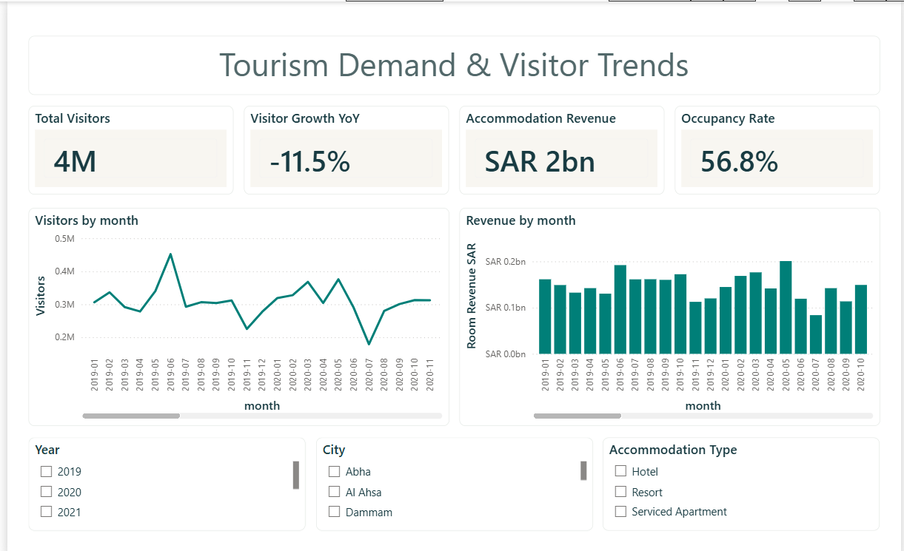
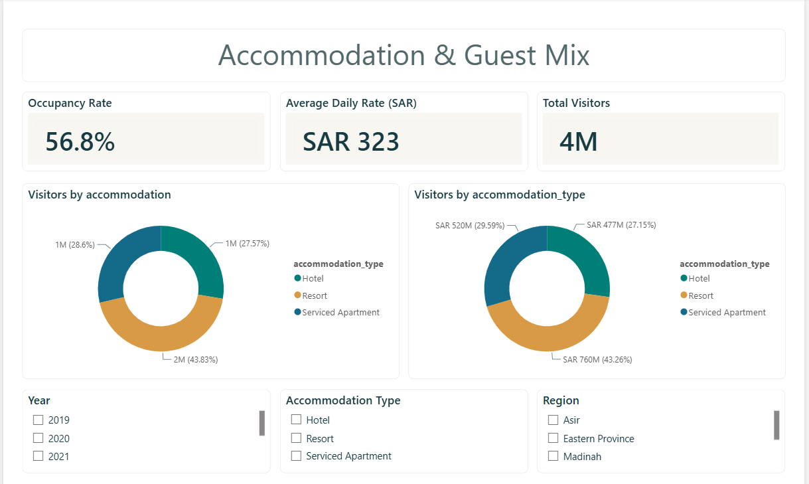

# Saudi Tourism & Hospitality Analytics

**Power BI | Python | SQL | Saudi tourism and accommodation performance**

I built this project to explore a question I kept coming back to: **when visitor numbers change, what happens to hotel revenue, room pricing and occupancy?**

Looking at visitor totals alone doesn't tell the whole story. A city can attract more visitors without generating the most accommodation revenue, and a strong average room rate doesn't necessarily mean rooms are consistently occupied.

I worked with **840 synthetic monthly observations across 10 Saudi cities (2019–2025)**, cleaned and summarized the data with Python and SQL, and brought the results together in a four-page Power BI report.

> **About the data:** This is my independent portfolio project, built using **simulated data**, not official Saudi tourism statistics or information from a real hotel operator. The results illustrate an analytical approach; they should not be presented as actual market performance.

## What I found

**Visitor demand softened in 2025, but revenue held up slightly better.** The modeled data shows **3.54M visitors** and **SAR 1.76B in accommodation revenue** in 2025. Compared with 2024, visitors declined by about **11.5%**, while revenue fell by around **9.4%**. Revenue per modeled visitor rose from **SAR 485 to SAR 496**. That difference made me look beyond visitor volume and pay more attention to revenue and pricing.

**Riyadh generated the most accommodation revenue in the dataset.** In 2025, Riyadh recorded approximately **SAR 289.5M** in modeled revenue from **487K visitors**, followed by Abha (**SAR 206.2M**) and Makkah (**SAR 195.5M**). Riyadh's capacity-weighted occupancy was **65.5%**, compared with **45.6% in Khobar**. Those differences suggest why a single nationwide occupancy figure can hide important local variation.

**Room pricing was fairly stable even as demand changed.** The capacity-weighted average daily rate (ADR) was around **SAR 323** in both 2024 and 2025, while modeled occupancy moved from **57.7% to 56.8%**. That doesn't prove what caused the revenue decline, but it gives a clearer starting point for investigating demand and room utilization.

## Why this analysis matters to a business

The value of this project isn't just the dashboard. It's how the same measures could support everyday decisions in a hotel group, tourism company or hospitality investment team.

| Business question | How the analysis could help |
| --- | --- |
| **Where should we focus sales and marketing?** | Compare visitor demand and revenue by city to identify markets worth investigating before allocating campaign budgets. |
| **Are our rooms being priced effectively?** | Track ADR alongside occupancy and revenue rather than judging pricing from one metric alone. |
| **Where might capacity be underused?** | Flag cities or accommodation segments with lower modeled occupancy for a closer look at demand, seasonality and inventory. |
| **How is performance changing?** | Use year-over-year trends to spot revenue or visitor declines early and support monthly management reviews. |
| **Which locations deserve deeper investment analysis?** | Use city-level comparisons to shortlist markets for further research—not to make investment decisions from synthetic data. |

**Business impact:** I haven't claimed cost savings, revenue growth or improvements that didn't actually happen. This is a decision-support demonstration: it shows how I would turn scattered tourism and accommodation metrics into a consistent view that helps teams ask better questions and prioritize where to investigate.

## Power BI dashboard

I split the report into four pages so each one answers a different question.

### 1. Tourism Demand & Visitor Trends

How have visitor activity and accommodation revenue changed over time?



### 2. City Tourism Performance

Which cities contribute the most revenue, and how does occupancy differ?


### 3. Accommodation Revenue & Pricing

What do room revenue and average daily rates tell us about pricing?


### 4. Accommodation & Guest Mix

How do the modeled accommodation categories compare?



## How I approached it

1. **Data preparation:** Checked the monthly records and worked with visitor, room-capacity, occupancy, ADR and accommodation-revenue fields.
2. **Python analysis:** Produced repeatable summaries for years, cities, months and accommodation categories.
3. **SQL analysis:** Queried trends and compared city-level revenue, visitors, occupancy and pricing.
4. **Power BI:** Built a four-page report with KPI cards, trend charts and slicers, using SAR for currency and percentages for occupancy.
5. **Interpretation:** Focused on what the differences could mean for marketing, pricing and management reporting.

For occupancy and ADR, I used **room-capacity-weighted averages** instead of averaging the percentages or prices from every record equally. **Revenue per visitor** is a calculated ratio of modeled totals; it isn't measured guest spending.

One limitation worth highlighting: the dataset has **one accommodation category per city-month observation**, so its category breakdowns aren't a complete representation of real hotel, resort or serviced-apartment market shares.

## Project structure

```text
assets/
  screenshots/                 # Four Power BI report screenshots
  Saudi_Tourism_Desert_Oasis_Theme.json
data/
  01_tourism_monthly_synthetic.csv
python/
  analyze_tourism.py
sql/
  tourism_analysis.sql
analysis/                     # Summary CSVs, JSON and SQLite database
powerbi/
  Saudi_Tourism.pbip
  Saudi_Tourism.pbix
  Saudi_Tourism.Report/
  Saudi_Tourism.SemanticModel/
POWER_BI_SETUP.md
README.md
```

**Explore the files:** [Power BI report](powerbi/Saudi_Tourism.pbip) · [PBIX](powerbi/Saudi_Tourism.pbix) · [Dataset](data/01_tourism_monthly_synthetic.csv) · [Python](python/analyze_tourism.py) · [SQL](sql/tourism_analysis.sql) · [Analysis outputs](analysis/) · [Theme](assets/Saudi_Tourism_Desert_Oasis_Theme.json)

To rerun the Python summaries from the repository root:

```bash
python python/analyze_tourism.py
```

The script uses Python's standard library and generates the analysis outputs and SQLite database. For Power BI, see [the setup instructions](POWER_BI_SETUP.md) to connect the CSV and refresh the report.

## What I'd do next

If I were developing this for a real hospitality team, my next step would be to work with verified visitor arrivals, room nights sold, available room nights and property-level revenue. That would let me calculate more meaningful operational metrics, investigate seasonality and compare locations on a like-for-like basis.

---

*Independent, self-directed analysis. All tourism figures in this repository are synthetic and are not official statistics or forecasts.*
