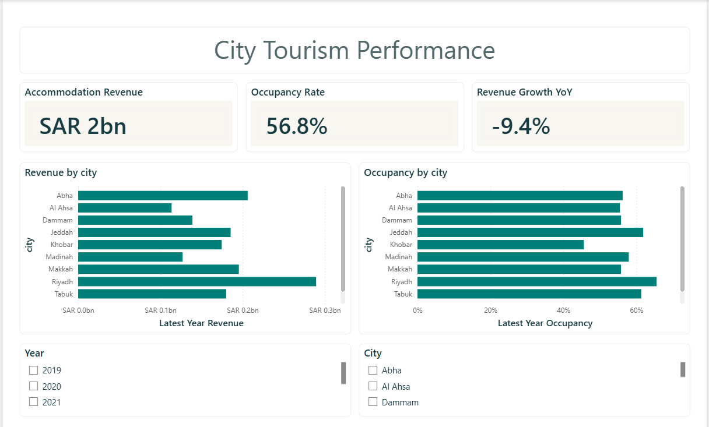
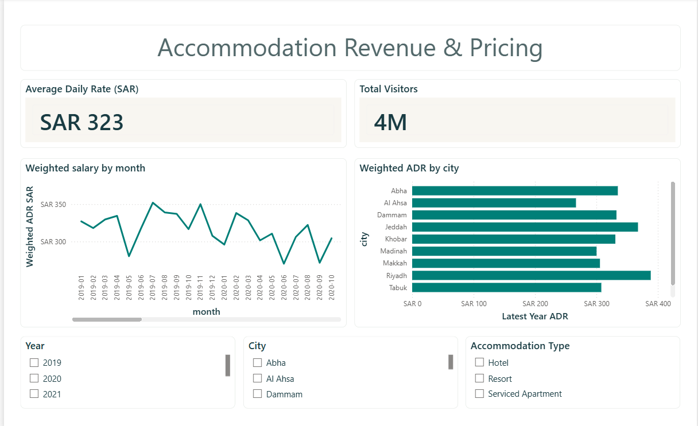

# Saudi Tourism & Hospitality Analytics

**Power BI · Python · SQL · Tourism market analysis**

I wanted to understand whether more visitors always mean more accommodation revenue—and whether occupancy and room prices tell the same story.

I explored a **synthetic monthly dataset covering 10 Saudi cities from January 2019 to December 2025**. I used Python and SQL to compare visitor activity, revenue, occupancy and pricing, then built dashboards to make the differences easier to see.

> **Data transparency:** This is a self-directed portfolio analysis using simulated data, **not official Saudi tourism statistics**. The numbers below describe the dataset, not actual hotel performance or verified visitor totals.

## What stood out to me

### 1. Visitors fell more than revenue in the latest modeled year

The dataset shows approximately **3.54 million visitors and SAR 1.76 billion in room revenue in 2025**. Compared with 2024, that's an **11.5% drop in visitors** and a **9.4% decline in revenue**. Revenue per visitor rose from around **SAR 485 to SAR 496**.

That doesn't prove visitors spent more individually—it's a ratio of modeled totals—but it shows why I wanted to look at revenue alongside visitor counts.

### 2. Riyadh leads on accommodation revenue

**Riyadh recorded about SAR 289.5 million** in modeled 2025 accommodation revenue and **487,343 visitors**. Abha followed on revenue at roughly **SAR 206.2 million**, then Makkah at **SAR 195.5 million**.

For me, the useful comparison is not just *which city attracts more visitors*, but *how much modeled accommodation revenue accompanies that activity*.

### 3. Occupancy and pricing add context

Capacity-weighted occupancy was **56.76% in 2025**, compared with **57.71% in 2024**, while the capacity-weighted average daily rate remained around **SAR 323**.

I wouldn't explain the revenue change using occupancy alone. I'd want to investigate city mix, accommodation mix and the underlying room-night inventory before making that claim.

### 4. Accommodation categories are not full market shares

The dataset records one accommodation type for each city-month observation. That means hotels, resorts and serviced apartments can be compared **within the modeled records**, but these totals don't represent complete real-world market shares.

## My Power BI dashboards

I organized the report into four pages:

1. **Tourism Demand & Visitor Trends** — visitor movement, room revenue and year-over-year change
2. **City Tourism Performance** — city comparisons, revenue and occupancy
3. **Accommodation Revenue & Pricing** — average daily rates and pricing trends
4. **Accommodation & Guest Mix** — differences by accommodation category

### Dashboard screenshots

[](01_Tourism_Demand_&_Visitor_Trends.png)

[](02_City_Tourism_Performance.png)

[](03_Accommodation_Revenue_&_Pricing.png)

[](04_Accommodation_&_Guest_Mix.png)

## How I calculated the metrics

- **Visitors and accommodation revenue:** totals within the selected time period.
- **Occupancy:** room-capacity-weighted average of modeled occupancy percentages, rather than a simple average of city records.
- **Average daily rate (ADR):** room-capacity-weighted average of modeled daily rates, in **SAR**.
- **Revenue per visitor:** modeled accommodation revenue divided by modeled visitors; not observed individual guest spending.
- **Year-over-year changes:** comparisons between complete calendar years.

I use **2025-only city comparisons** so that I don't accidentally treat observations from different years as one current market snapshot.

## Project files

| File or folder | Purpose |
| --- | --- |
| [Dataset](data/01_tourism_monthly_synthetic.csv) | Synthetic monthly observations (upload pending) |
| [Python](python/analyze_tourism.py) | Validation and repeatable summary calculations |
| [SQL](sql/tourism_analysis.sql) | Trend, city, occupancy and revenue queries |
| [Analysis outputs](analysis/) | Generated CSVs, JSON and SQLite database |
| [Power BI project](powerbi/Saudi_Tourism.pbip) | Editable four-page report |

| [Power BI setup](POWER_BI_SETUP.md) | Local data-source setup and refresh |

To regenerate the analysis from the repository root, run:

```bash
python python/analyze_tourism.py
```

The script uses the Python standard library. The SQL queries run against `analysis/tourism.sqlite`.

The Power BI project needs its CSV path updated and refreshed on the machine opening it. The PBIP was generated programmatically and should be checked visually in Power BI Desktop before treating it as a fully verified report.

## What I'd improve next

I'd like to compare these simulated patterns with official Saudi tourism data, add room-night inventory to improve occupancy calculations, and make sure every city-month includes all accommodation categories. Those steps would make the analysis more useful for real market decisions.

---

*Independent portfolio project. All figures are modeled estimates and should not be used as real-world tourism forecasts or investment guidance.*
